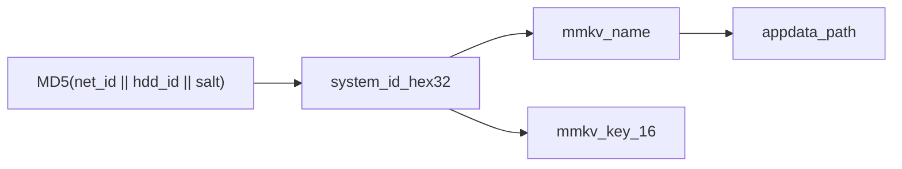
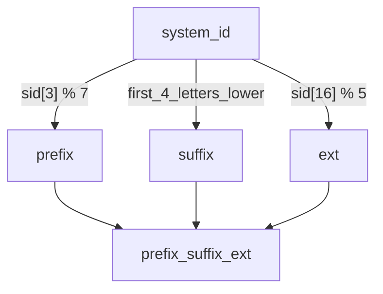

# CF12

CF12 指 QQ 音乐 `CommonFunction.dll` 的 **ordinal 12** 导出（无函数名）。该函数根据本机硬件标识材料，向调用方缓冲写入 MMKV 文件名与密钥（各最多 `0x40` 字节）。

原始签名（见 [`qmpc_fn12.asm`](../libqmpc/src/common_function/qmpc_fn12.asm)）：

```c
void __stdcall fn12(char* mmkv_key, char* mmkv_name);
```

调用约定为 `__stdcall`；结果写回调用方提供的两个缓冲。

## 本库对应

| 符号                                                               | 说明                                  |
| ------------------------------------------------------------------ | ------------------------------------- |
| [`qmpc_cf12_t`](../libqmpc/include/libqmpc/common_function/cf12.h) | 输出：`mmkv_path`、`mmkv_key`         |
| `qmpc_cf12_get_via_hwid`                                           | 本地复现 CF12 逻辑，不加载 DLL        |
| `qmpc_cf12_get_via_rpc`                                            | 注入调用真实 ordinal 12（本文不展开） |

## `qmpc_cf12_get_via_hwid`

实现见 [`cf12.c`](../libqmpc/src/common_function/cf12.c)、[`ordinal_12.c`](../libqmpc/src/common_function/ordinal_12.c)。

1. `system_id ← qmpc_hwid_system_id()`：网卡 ID + 磁盘 ID + 固定盐的 MD5，按 UUID 风格重排字节序后输出 **32 位大写十六进制**（非 Windows 为占位零串）。
2. `name ← qmpc_mmkv_system_id_to_name(system_id)`。
3. `mmkv_path ←` AppData/`Tencent/QQMusic/` + `name`（`qmpc_get_appdata_file_path`）。
4. `mmkv_key ←` `system_id` 前 16 字符（`qmpc_mmkv_system_id_to_key`）。

当前实现恒返回 `true`；失败时 path/key 可能为空串。



### 文件名推导

`qmpc_mmkv_system_id_to_name`：

| 分量     | 规则                                                     |
| -------- | -------------------------------------------------------- |
| `prefix` | 固定字符抽取 `prefixes[system_id[3] % 7]`                |
| `suffix` | 扫描 `system_id[0..31]`，跳过数字，取前 4 个字母并转小写 |
| `ext`    | 固定字符抽取 `exts[system_id[16] % 5]`                   |

最后拼接在一起。


