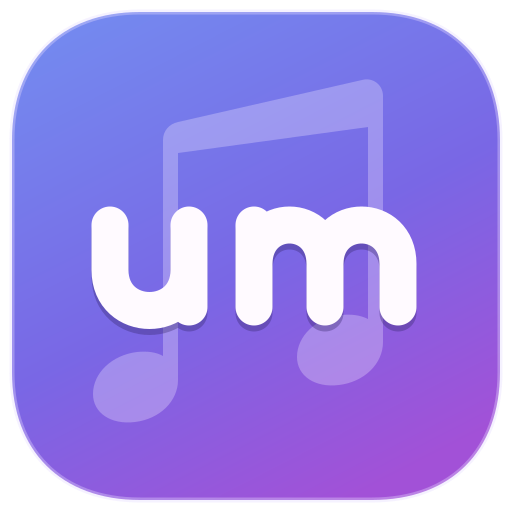
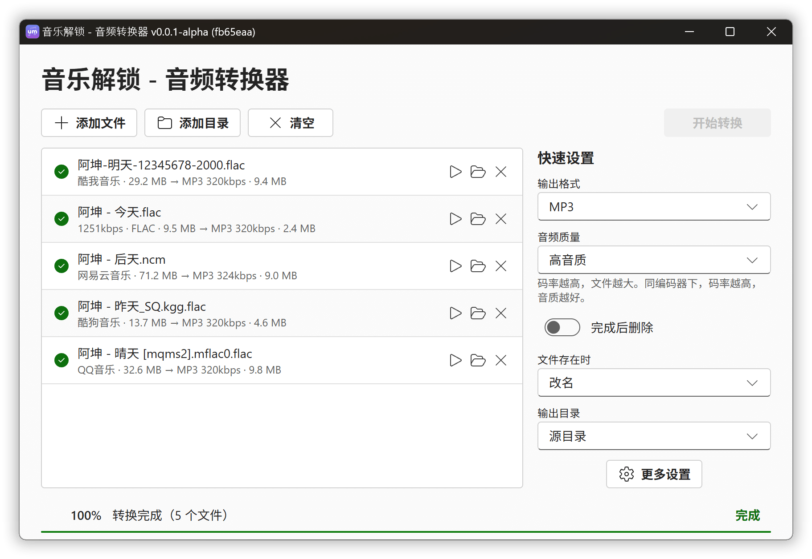
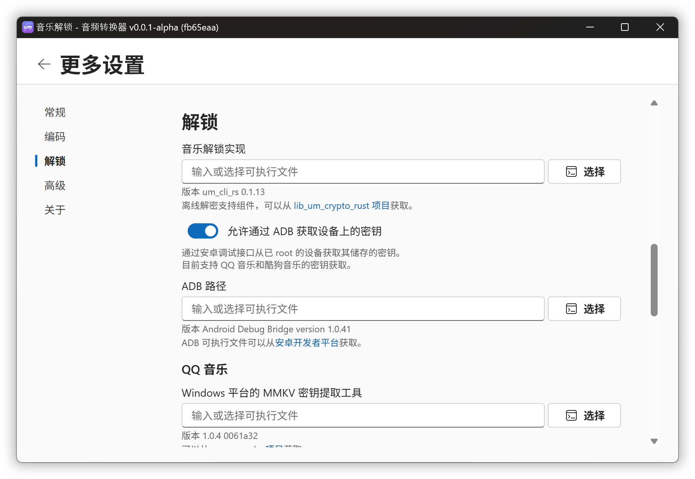

# 音乐解锁 - 音频转换 GUI

桌面音频解密与格式转换工具，支持将主流音视频文件以及常见加密音乐格式批量转换为 `MP3`、`M4A`、`OGG`、`FLAC`、`WAV`。

 

## 支持的文件格式

- 常规音视频：`MP3`、`WAV`、`FLAC`、`AAC`、`M4A`、`OGG`、`WMA`、`MKV`、`WEBM`
- 流媒体：
  - 网易云：`.ncm`
  - QQ 音乐：`.mflac`、`.mgg`、`.mmp4`（含常见变体后缀）
  - 酷狗：`.kgm`、`.vpr`、`.kgg`、`.kgma`
  - 酷我：`.kwm`（以及部分加密 `.flac`）
- 输出格式：`MP3`、`M4A`、`OGG`、`FLAC`、`WAV`

## 项目截图

## 外部工具

在可执行程序目录下建立 `bin` 目录并将二进制文件放入即可。程序会优先使用该目录下的可执行文件，其次回退到系统 `$PATH` 中的可执行文件。

- `ffmpeg`：用于音频转码与媒体信息读取。推荐下载 [Jellyfin 编译的 ffmpeg 副本](https://github.com/jellyfin/jellyfin-ffmpeg/releases/latest)。
- `um_cli_rs`：解密加密音乐文件时必需，可从 [lib_um_crypto_rust 发布页](https://git.um-react.app/um/lib_um_crypto_rust/releases/) 获取。
- `qmpc-mmkv-cli`：Windows 下部分 QQ 音乐文件需要从本机客户端提取密钥时使用，可从 [qmpc-mmkv 发布页](https://git.um-react.app/um/qmpc-mmkv/releases) 获取。
- `adb`：从已 root 的 Android 设备上读取密钥时使用（默认关闭）。可从 [Android Platform Tools](https://developer.android.com/studio/releases/platform-tools#downloads) 获取。项目不提供 root 教程；root 有风险，操作需谨慎。

## 便携模式

程序默认储存试用 `%APPDATA%\um-conv\um-conv.toml`，运行日志保存在同目录下的 `um-conv.log`。

若主程序目录下存在 `um-conv.toml` 配置文件，应用会以便携模式启动，而非写出到用户个人数据目录。

## 转换设置

- 在设置页「常规」中可开关并行转换（默认开启），关闭时会隐藏并行数量输入框；并行数量为 0 或负数时使用 CPU 核心数，大于 256 时按 256 计。
- 进度条显示「已处理 x/y 个文件，成功 a，跳过 b，错误 z」，不再显示当前文件名；失败原因会出现在文件列表副标题，完整详情请查看日志。
- Windows 下转换与探测子进程以空闲优先级运行。

## 开发者文档

如需从源码构建、了解架构或参与开发，请参阅 [开发文档](docs/README.md)。

## LLM 协作声明

该项目使用 Codex、Cursor、AntiGravity 进行许愿范式编程并快速迭代，代码质量不代表开发者水平。
